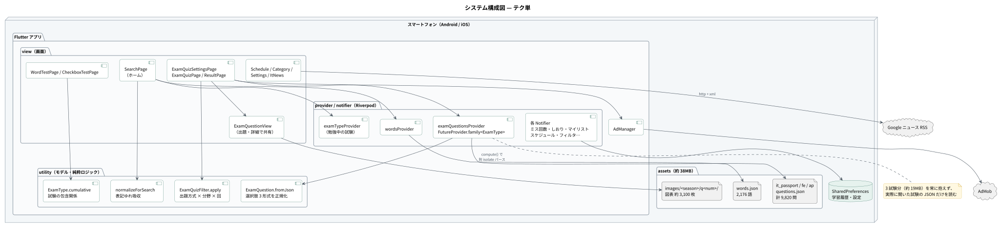
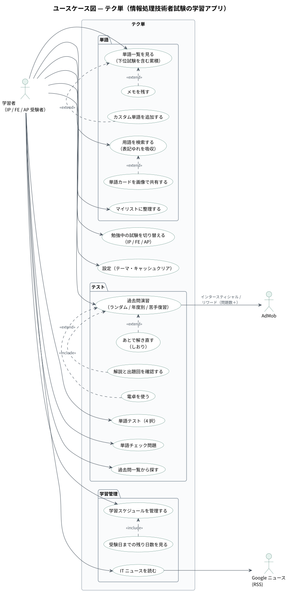
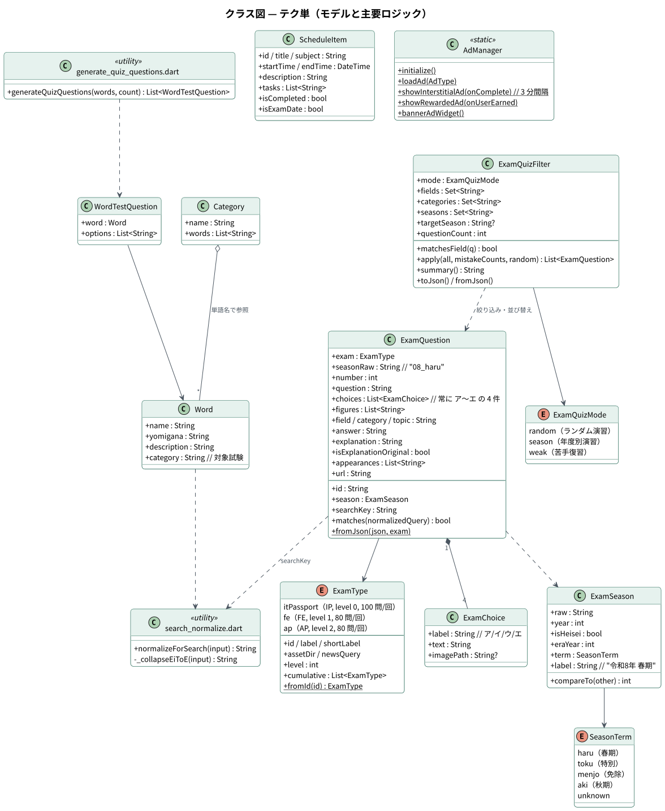
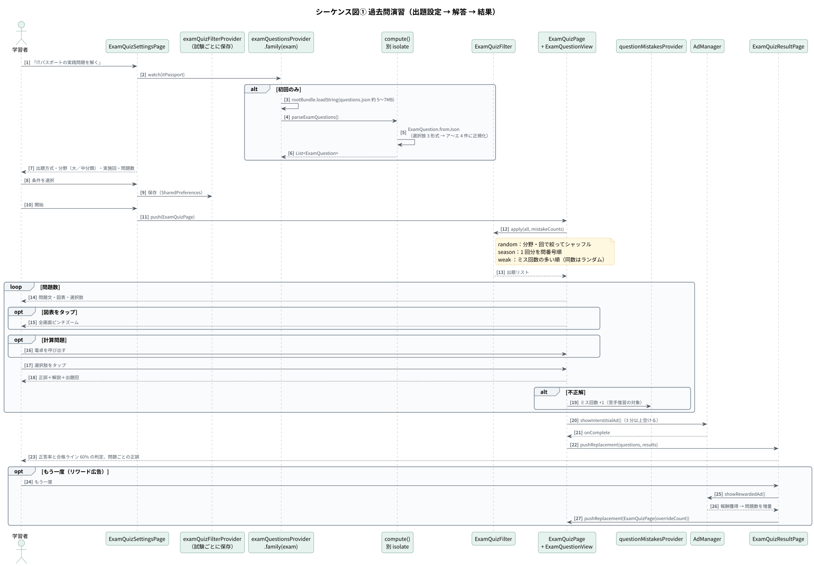
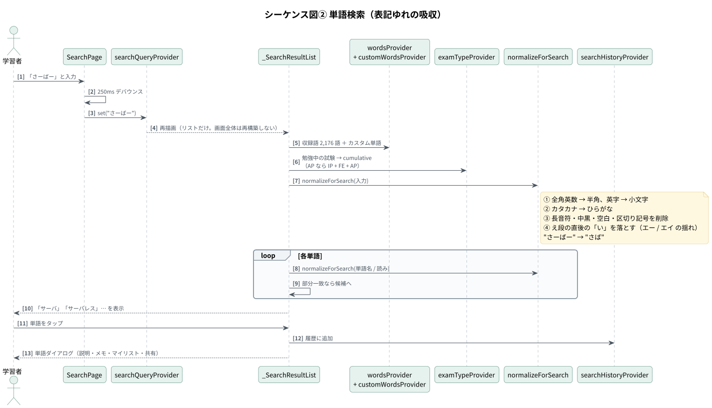
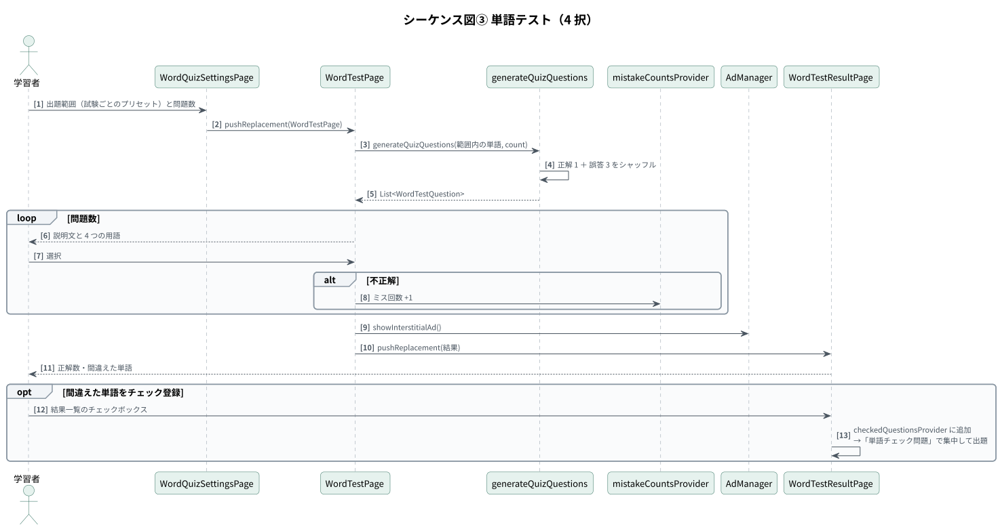

# 設計書 — テク単

1. [システム構成](#1-システム構成)
2. [レイヤー構成と責務](#2-レイヤー構成と責務)
3. [クラス図](#3-クラス図)
4. [シーケンス図](#4-シーケンス図)
5. [データ設計](#5-データ設計)
6. [性能・容量への配慮](#6-性能容量への配慮)
7. [データの権利処理（解説の自前化）](#7-データの権利処理解説の自前化)
8. [ディレクトリ構成](#8-ディレクトリ構成)

図の PlantUML ソースは [`diagrams/src/`](diagrams/src/)、SVG は [`diagrams/svg/`](diagrams/svg/) にあります。

---

## 1. システム構成



学習データ（単語 2,176 語・過去問 9,820 問・図表 約 3,100 枚）はすべてアプリに同梱し、**オフラインで学習できる**構成です。外部と通信するのは IT ニュース（Google ニュース RSS）と広告（AdMob）だけです。

### ユースケース



---

## 2. レイヤー構成と責務

| レイヤー | 場所 | 責務 |
|---|---|---|
| View | `lib/view/` | 画面と共通ウィジェット（`WordCard`, `CommonWordListView`, `ExamQuestionView`, `ExamSwitcher`） |
| Provider | `lib/provider/` | Riverpod の Provider 定義（データ読み込み・派生値） |
| Notifier | `lib/notifier/` | 永続化を伴う状態更新（`SharedPreferences` への保存） |
| Utility | `lib/utility/` | データモデルと**純粋ロジック**（出題条件・表記ゆれ正規化・試験の包含関係・和暦の解釈） |
| Ads | `lib/ads/` | AdMob の読み込み・表示頻度の制御 |
| Tool | `tool/` | 開発用 CLI（アセット一覧の生成、解説差し替えと進捗確認） |

**Provider と Notifier を分けた理由**：読み込むだけのもの（過去問 JSON、単語 JSON、派生値）は `FutureProvider` / `Provider`、ユーザー操作で変わり保存が必要なもの（ミス回数・しおり・マイリスト・スケジュール・出題条件）は `Notifier` と、データの性質で使い分けています。

### 試験の包含関係

IP（ITパスポート）⊂ FE（基本情報）⊂ AP（応用情報）という包含関係を、`ExamType.level` と `cumulative` の 1 か所で表現しています。単語データは**試験をまたいで重複しない差分**で持ち、表示・出題は下位試験を含む累積で行います。単語一覧・ホームのおすすめ・単語テストの範囲プリセットがこの定義を共有します。

---

## 3. クラス図



---

## 4. シーケンス図

### 4-1. 過去問演習



### 4-2. 単語検索（表記ゆれの吸収）



### 4-3. 単語テスト



---

## 5. データ設計

### 5-1. 同梱データ

| ファイル | 件数 | 内容 |
|---|---|---|
| `assets/words.json` | 2,176 語 | `name` / `yomigana` / `description` / `category`（対象試験） |
| `assets/it_passport/questions.json` | 2,980 問 | 30 回分（令和 8 年度春期まで） |
| `assets/fe/questions.json` | 3,400 問 | 43 回分 |
| `assets/ap/questions.json` | 3,440 問 | 43 回分 |
| `assets/<exam>/images/<season>/q<num>/` | 約 3,100 枚 | 問題の図表・選択肢画像 |

過去問 1 件の形式：

```json
{
  "season": "08_haru",
  "num": 3,
  "question": "投資会社であるA社が…",
  "options": ["ア −15", "イ 0", "ウ 5", "エ 20"],
  "images": ["q3.png"],
  "classification": "ストラテジ系 » 企業活動 » 業務分析・データ利活用",
  "answer": "エ",
  "explanation": "…",
  "explanationSource": "tech_tan",
  "appearances": [],
  "url": "…"
}
```

### 5-2. 選択肢の正規化

収録データの選択肢には 3 通りの持ち方があります。`ExamQuestion.fromJson` で常に「ア・イ・ウ・エの 4 件」へ正規化するため、描画側は分岐なしで扱えます。

| 形式 | 例 | 正規化後 |
|---|---|---|
| ① 本文入りの 4 択 | `["ア a, b", "イ a, b, c", …]` | ラベルと本文に分割 |
| ② 記号のみ＋選択肢画像 | `["ア","イ","ウ","エ"]` ＋ `23a/23i/23u/23e.png` | ラベルと画像パス |
| ③ 4 択が問題図の中にある | `["ア イ ウ エ"]` | 本文なしの 4 件（図を参照） |

### 5-3. 端末内に保存するデータ（SharedPreferences）

| キー | 内容 |
|---|---|
| `selected_exam` | 勉強中の試験 |
| `exam_quiz_filters` | 実践問題の出題条件（試験ごと） |
| `word_quiz_filters` | 単語テストの出題範囲（試験ごと） |
| `question_mistake_counts` | 過去問のミス回数（問題 ID → 回数） |
| `mistake_counts` | 単語テストのミス回数 |
| `checked_exam_questions` | あとで解き直す問題（しおり） |
| `checked_questions` | 単語チェック問題に登録した単語 |
| `saved_items` / `saved_categories` | 保存した単語・マイリスト |
| `custom_words` | 自分で追加した単語 |
| `schedule_items` | スケジュール・受験日 |
| `search_history` | 検索履歴 |
| `theme_mode` / `use_material3` | テーマ設定 |

---

## 6. 性能・容量への配慮

| 課題 | 対策 |
|---|---|
| 過去問 JSON が 3 試験で約 19MB（解説を含む開発版。公開版は約 9MB） | `examQuestionsProvider` を `FutureProvider.family<…, ExamType>` にし、**実際に開いた試験だけ**を読む |
| JSON のパースで UI が固まる | `compute()` で別 isolate に逃がす（`parseExamQuestions` / `parseWords` はトップレベル関数） |
| 検索の入力ごとに画面全体が再構築される | 250ms デバウンス＋検索結果リストだけを別ウィジェットに切り出して再描画 |
| Flutter のアセット指定はディレクトリを再帰しない | 画像を含む約 1,900 ディレクトリを `tool/generate_asset_list.dart` で `pubspec.yaml` に生成。登録漏れはテストで検出 |
| APK サイズ（開発版の universal で約 85MB） | App Bundle または `--split-per-abi` で配信 |
| 広告の出しすぎ | インタースティシャルは 3 分、アプリ起動広告は 2 時間の間隔制限 |

---

## 7. データの権利処理（解説の自前化）

| 要素 | 著作者 | 扱い |
|---|---|---|
| 問題文・選択肢・図表 | IPA | 公表された過去問題として利用 |
| 分類（ストラテジ系 » 法務 » …） | IPA シラバス準拠 | そのまま利用 |
| 解説文 | 収集元サイト | **テク単の文章へ順次差し替え**（`explanationSource: "tech_tan"`） |

差し替えは `tool/rewrite_explanations.dart` で行い、適用前に次を検証して 1 件でも問題があれば何も書き換えません。

- 40〜1,200 字に収まっているか
- 正解の記号（ア〜エ）に言及しているか（根拠の読めない解説を防ぐ）
- **元の解説と 25 文字以上連続して一致していないか**（書き直しではなく写しになっていないか）
- 同じ問題が複数の回に出ている場合は、本文が一致する問題すべてに反映（重複 1,484 問）

> ポートフォリオとして公開しているリポジトリでは、差し替えが済んでいない解説文を同梱していません（アプリ上は「解説は登録されていません。」と表示されます）。

---

## 8. ディレクトリ構成

```
lib/
├── main.dart          エントリーポイント（広告 SDK 初期化とテーマ設定）
├── ads/               AdMob 広告の読み込み・表示
├── notifier/          Notifier（永続化を伴う状態の更新）
├── provider/          Riverpod の Provider 定義
├── utility/           データモデルと純粋ロジック
└── view/              画面
    ├── category_page/  マイリスト
    ├── schedule_page/  学習スケジュール
    ├── setting_page/   設定
    ├── test_page/
    │   ├── check_test/ 単語チェック問題
    │   ├── exam_test/  実践問題（過去問）
    │   └── word_test/  単語テスト
    └── widget/         共通ウィジェット
tool/
├── generate_asset_list.dart     pubspec.yaml のアセット一覧を生成
├── rewrite_explanations.dart    解説を自前の文章へ差し替える
└── check_explanations.dart      自前化の進捗と次の着手対象を確認
test/
├── assets/            同梱データの整合性テスト
└── utility/           純粋ロジックの単体テスト
```
