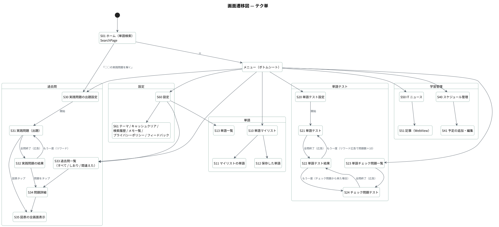

# 画面定義書 — テク単

| 項目 | 内容 |
|---|---|
| 対象 | テク単（Flutter / Android・iOS） |
| 画面数 | 主要 25 画面（ホーム・単語 4・単語テスト 5・過去問 6・学習管理 4・設定 7 ほか） |
| 画面遷移図 | [diagrams/svg/screen-transition.svg](diagrams/svg/screen-transition.svg) |
| 共通仕様 | フォント Murecho、テーマ（ライト／ダーク／システム）と Material 3 の ON/OFF を切替可能。主要画面の下部に AdMob バナー。`ResponsiveSizes`（`BuildContext` 拡張）で余白・文字サイズを画面幅に追従 |

---

## 1. 画面一覧

| ID | 画面名 | 実装（`lib/view/`） | 概要 |
|---|---|---|---|
| S01 | ホーム（単語検索） | `search_page.dart` | 試験切替・単語検索・実践問題への導線・メニュー |
| S10 | 単語マイリスト | `category_page/category_selection_page.dart` | マイリストの作成・削除・並び替え |
| S11 | マイリストの単語 | `category_page/category_items_page.dart` | リスト内の単語一覧 |
| S12 | 保存した単語 | `saved_items_page.dart` | 保存した単語。スワイプ削除・ドラッグ並び替え |
| S13 | 単語一覧 | `word_list_page.dart` | 選択中の試験までの累積で全単語を表示、カスタム単語の追加 |
| S20 | 単語テスト設定 | `test_page/word_test/word_quiz_settings_page.dart` | 出題範囲（試験ごと）と問題数 |
| S21 | 単語テスト | `test_page/word_test/word_test_page.dart` | 説明文から用語を当てる 4 択 |
| S22 | 単語テスト結果 | `test_page/word_test/word_test_result_page.dart` | 正解数・各問の正誤・チェック登録・もう一度 |
| S23 | 単語チェック問題一覧 | `test_page/check_test/checked_questions_page.dart` | チェック登録した単語 |
| S24 | チェック問題テスト | `test_page/check_test/checkbox_test_page.dart` | チェック登録した単語だけで出題 |
| S30 | 実践問題の出題設定 | `test_page/exam_test/exam_quiz_settings_page.dart` | 出題方式・分野・実施回・問題数 |
| S31 | 実践問題（出題） | `test_page/exam_test/exam_quiz_page.dart` | 過去問の 4 択。解説・電卓・しおり |
| S32 | 実践問題の結果 | `test_page/exam_test/exam_quiz_result_page.dart` | 正答率・合格ライン 60%・問題ごとの正誤 |
| S33 | 過去問一覧 | `test_page/exam_test/exam_questions_list_page.dart` | 全問／しおり／間違えた問題、分野・回で絞り込み、本文検索 |
| S34 | 問題詳細 | `test_page/exam_test/exam_question_detail_page.dart` | 1 問を解く・解答と解説を見る |
| S35 | 図表の全画面表示 | `widget/exam_image_view.dart` | ピンチズーム |
| S40 | スケジュール管理 | `schedule_page/schedule_management_page.dart` | カレンダー・受験日カウントダウン・タスク |
| S41 | 予定の追加・編集 | `schedule_page/add_edit_schedule_page.dart` | 予定・タスク・受験日 |
| S50 | IT ニュース | `it_news_page.dart` | 試験別タブで Google ニュース RSS を表示 |
| S51 | 記事 | `news_web_view_page.dart` | WebView（http/https のみ許可） |
| S60 | 設定 | `setting_page/settings_page.dart` | 各設定画面への入口 |
| S61 | テーマ設定 | `setting_page/theme_settings_page.dart` | ライト／ダーク／システム、Material 3 |
| S62 | キャッシュクリア | `setting_page/cache_clear_screen.dart` | 項目ごとに学習データを削除 |
| S63 | 検索履歴 ／ メモ一覧 | `setting_page/search_history_page.dart`, `memo_list_page.dart` | 履歴・メモの確認と削除 |
| S64 | プライバシーポリシー ／ フィードバック | `setting_page/privacy_policy.dart`, `feedback_page.dart` | 規約表示・問い合わせフォーム |

---

## 2. 主要画面の詳細

### S01 ホーム（単語検索）

| No | 項目 | 種別 | 内容・表示ルール |
|---|---|---|---|
| 1 | メニュー | アイコン（AppBar） | ボトムシートで 8 項目（単語マイリスト／単語テスト／単語チェック問題／実践問題／過去問一覧／スケジュール管理／IT ニュース／設定） |
| 2 | 試験切替 | セグメント（`ExamSwitcher`） | IP／FE／AP。選択は永続化され、実践問題・単語テスト・ニュースの既定範囲がまとめて切り替わる |
| 3 | 単語名を入力 | 検索欄 | 250ms デバウンス。`normalizeForSearch` で表記ゆれを吸収（長音・カタカナ／ひらがな・全角／半角・区切り記号・エー／エイ） |
| 4 | ◯◯の実践問題を解く | ボタン | S30 へ |
| 5 | 検索結果 | 単語カード（`WordCard`） | 試験バッジ（IP／FE／AP）・用語名・説明。選択中の試験までの累積で表示。カスタム単語も含む |
| 6 | 単語カードの操作 | タップ／長押し | タップで詳細ダイアログ（説明・メモ・共有）。長押しで保存／マイリスト／チェック登録 |
| 7 | バナー広告 | AdMob | |

---

### S30 実践問題の出題設定

| No | 項目 | 種別 | 内容・表示ルール |
|---|---|---|---|
| 1 | 試験切替 | セグメント | ホームと共有 |
| 2 | 出題方式 | ラジオボタン | ランダム演習（分野・回を絞ってランダム）／年度別演習（1 回分を本番と同じ順）／苦手復習（間違えた問題をミスの多い順） |
| 3 | 出題分野 | チェック＋展開 | 大分類（ストラテジ系／マネジメント系／テクノロジ系）と中分類。未選択なら全分野 |
| 4 | 出題する回 | チップ | 「全期間」「直近5回」と個別の回（令和8年春期…）。年度別演習では 1 回を選択 |
| 5 | 問題数 | チップ | 10／20／30／50 問 |
| 6 | 開始 | ボタン | 条件に合う問題がなければ無効。S31 へ |

| 業務ルール |
|---|
| 設定は試験ごとに `SharedPreferences` へ保存し、次回も同じ条件で始められる |
| 過去問データは初回表示時に読み込む（読み込み中は「過去問データを読み込んでいます…」） |

---

### S31 実践問題（出題）／ S34 問題詳細

  

出題画面と問題詳細画面は、同じ `ExamQuestionView` を共有しています。

| No | 項目 | 種別 | 内容・表示ルール |
|---|---|---|---|
| 1 | 電卓 | アイコン（AppBar） | ボトムシートの電卓（`math_expressions`）。稼働率・基数変換などの計算問題向け |
| 2 | しおり | アイコン（AppBar） | 「あとで解き直す」に登録／解除 |
| 3 | お問い合わせ | アイコン（AppBar） | 問題の誤りなどを報告 |
| 4 | 進捗 | テキスト＋バー | 「問題 1 / 10」「正解 0」 |
| 5 | メタ情報 | チップ | 実施回・問番号・大分類。分類のパンくず（マネジメント系 > プロジェクトマネジメント > …） |
| 6 | 問題文 | テキスト | |
| 7 | 図表 | 画像 | タップで S35（全画面ピンチズーム） |
| 8 | 選択肢 | ボタン × 4 | ア〜エ。選択肢が画像の問題にも対応 |
| 9 | 正誤 | 表示 | 正解は緑のチェック、不正解は「不正解。正解は ウ です」 |
| 10 | 解説 | テキスト | 解説がない問題は「解説は登録されていません。」 |
| 11 | 次の問題へ | ボタン | 最終問題の後はインタースティシャル広告 → S32 |
| 12 | （S34）解く／解答・解説 | タブ | 詳細画面では解かずに解答と解説だけを見ることもできる |
| 13 | （S34）苦手リストから外す | ボタン | 「この問題は克服した」でミス回数をリセット |

| 業務ルール |
|---|
| 不正解のたびに問題 ID ごとのミス回数を加算し、苦手復習と「間違えた問題」一覧に反映 |
| 選択肢の持ち方 3 通り（本文入り／記号＋選択肢画像／問題図の中に描かれた 4 択）を `ExamQuestion.fromJson` で常に「ア〜エの 4 件」に正規化し、描画側は分岐しない |

---

### S32 実践問題の結果

| No | 項目 | 種別 | 内容 |
|---|---|---|---|
| 1 | 正答率 | 数値 | 正解数／出題数と % |
| 2 | 合格ライン | 判定 | 60% 以上で達成表示 |
| 3 | 問題ごとの正誤 | カード | タップで S34 |
| 4 | ホームに戻る | ボタン | ルートまで戻る |
| 5 | もう一度 | ボタン | リワード広告を視聴すると問題数を増量して再挑戦 |

---

### S33 過去問一覧

| No | 項目 | 種別 | 内容・表示ルール |
|---|---|---|---|
| 1 | 試験切替 | セグメント | |
| 2 | 検索欄 | テキスト入力 | 「問題文・分野から探す」。単語検索と同じ正規化規則 |
| 3 | 絞り込み | チップ | すべて／あとで解き直す／間違えた問題／ストラテジ系… |
| 4 | 回 | ドロップダウン | 「すべての回」または個別の回 |
| 5 | 問題 | リスト | 問題文の冒頭・実施回・問番号・分類。タップで S34 |

---

### S13 単語一覧

| No | 項目 | 種別 | 内容・表示ルール |
|---|---|---|---|
| 1 | 範囲 | ドロップダウン | 「応用情報技術者まで（IP + FE + AP）」のように累積で表示。収録語数を併記 |
| 2 | 絞り込み | 選択 | 全て／自分で追加した単語 |
| 3 | 単語カード | リスト | 長押しメニュー：保存する／単語チェック問題に登録する／（カスタム単語のみ）この単語を削除 |
| 4 | ＋ | FAB | カスタム単語の追加ダイアログ。同名は「同じ名前の単語が既に登録されています。」 |

| 選択中の試験 | 学習範囲 | 収録語数 |
|---|---|---|
| ITパスポート | IP | 673 語 |
| 基本情報技術者 | IP + FE | 1,456 語 |
| 応用情報技術者 | IP + FE + AP | 2,176 語 |

---

### その他の画面

| ID | 主な表示項目・操作 |
|---|---|
| S10〜S12 | マイリストの作成（ダイアログ）・削除（確認）・ドラッグ＆ドロップ並び替え。保存した単語はスワイプで削除 |
| S20〜S24 | 説明文から用語を選ぶ 4 択。誤答の選択肢は全単語から集める（消去法で解けない）。結果画面で各単語をチェック登録し、チェック問題だけで再テストできる |
| S40〜S41 | `table_calendar` のカレンダー。受験日は最大 3 件、残り日数を表示。タスクは「過去／本日／未来／完了」に分類 |
| S50〜S51 | 試験別タブ（勉強中の試験を初期選択）。Google ニュース RSS を `http` + `xml` で取得。記事は WebView で開き、http/https 以外の遷移は許可しない |
| S62 | 検索履歴・ミス回数・マイリスト・メモ・スケジュールなどを項目ごとに削除し、`flutter_phoenix` でアプリを再起動 |
