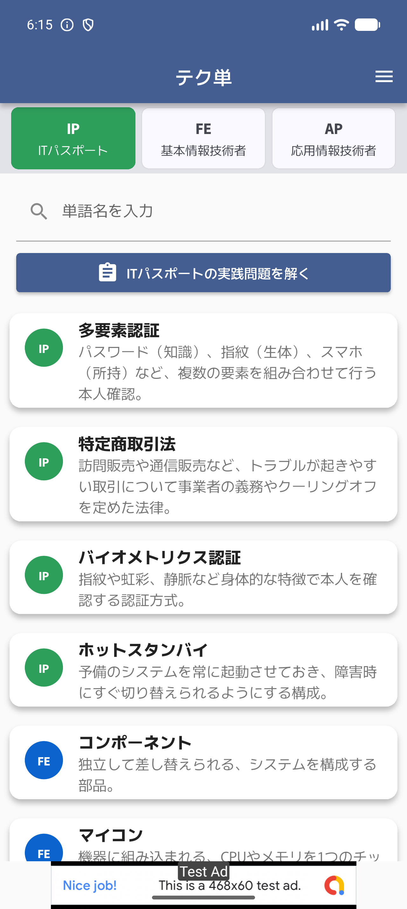
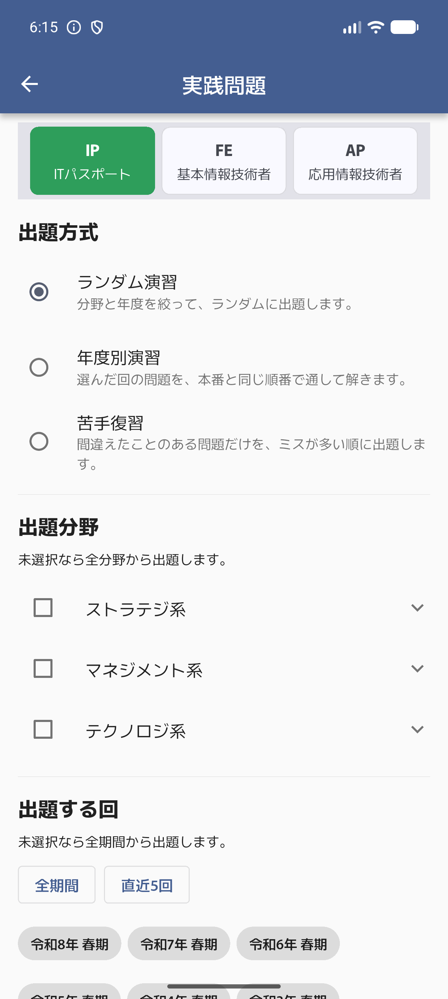
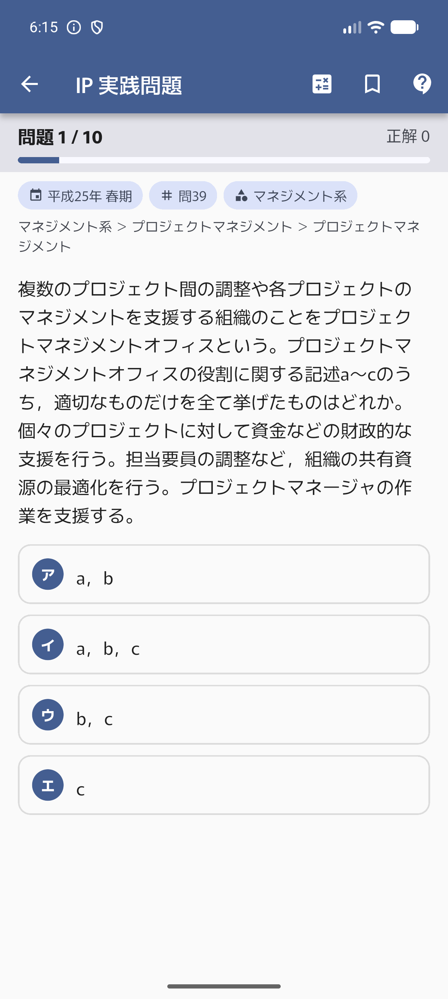
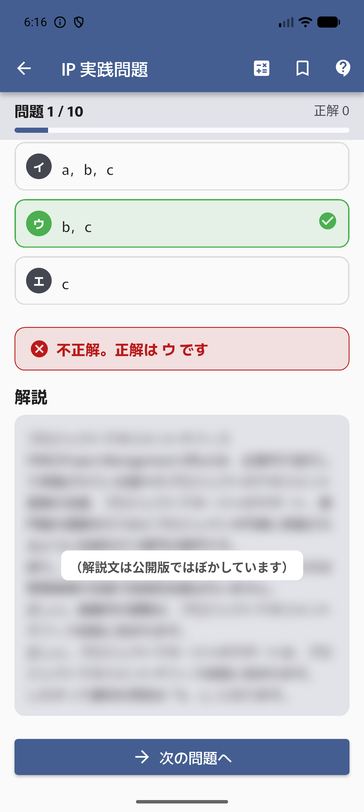
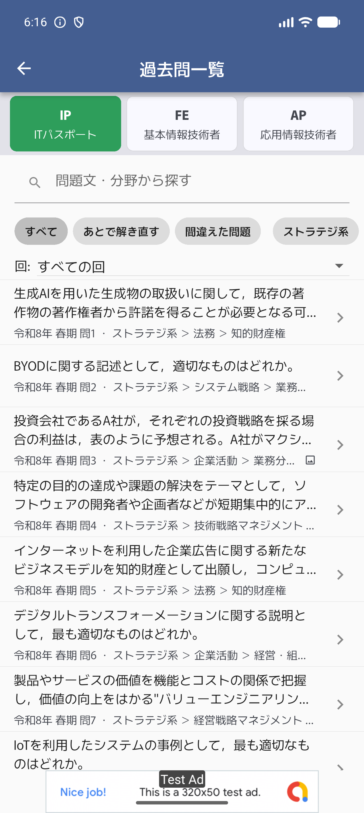
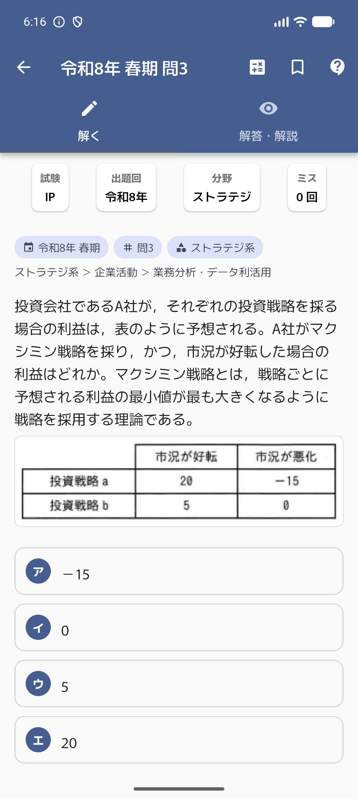
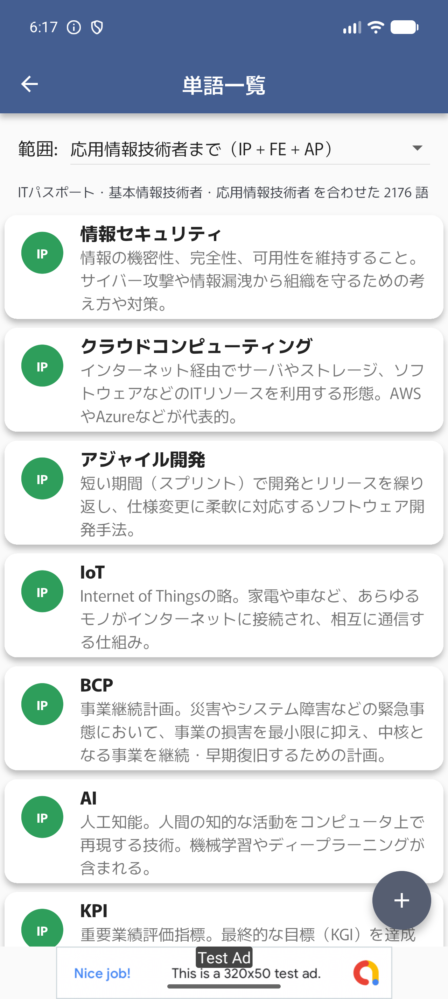

# テク単

> **ポートフォリオ作品**（[作品一覧へ](https://github.com/sawai-naoki-portfolio)）。設計資料（要件定義書・画面定義書・設計書・テスト結果・UML 図）は [`Doc/`](Doc/README.md) にあります。
>
> | 項目 | 内容 |
> |---|---|
> | 開発 | 個人開発。企画・仕様決め・設計の判断・レビュー・テストでの検証は自分で行い、実装とドキュメント作成には生成 AI（Claude Code）を活用 |
> | 開発時期 | 2026 年 7 月（コミットの記録: 7/28〜7/29） |
> | 公開状況 | 未公開 |

情報処理技術者試験の勉強に、頼れる強い味方。

| ホーム（単語検索） | 実践問題の出題設定 | 出題画面 | 解答後の解説 |
| :---: | :---: | :---: | :---: |
|  |  |  |  |

| 過去問一覧 | 図表つきの問題詳細 | 単語一覧（累積表示） |
| :---: | :---: | :---: |
|  |  |  |

> スクリーンショットはデバッグビルドのため、広告はすべて Google 公式のテスト広告です。

> **設計ドキュメント** — 要件定義書・画面定義書・設計書（クラス図／シーケンス図／画面遷移図）・テスト仕様は
> [`Doc/`](Doc/README.md) にまとめています。

## 概要 (Overview)

「テク単」は、**ITパスポート / 基本情報技術者 / 応用情報技術者** を目指す学習者のための、
IT用語の単語帳と過去問演習をひとつにまとめた学習アプリケーションです。

資格アプリシリーズ「簿記単」の続編として、同じ設計思想・UI/UX を引き継ぎつつ、
出題形式は情報処理技術者試験に合わせて作り直しています。

用語の検索・暗記から、過去問での実力試し、学習スケジュールの管理までをこのアプリ一つでサポートします。

## 主な機能 (Features)

### 📚 3 試験対応の単語データベース（累積モデル）

- IT・情報処理の用語を **2,176語** 収録。ITパスポート / 基本情報技術者 / 応用情報技術者の 3 試験ぶんを、
  対象試験のバッジ（IP / FE / AP）付きで一覧できます。
- ホーム上部の切り替えで「いま勉強している試験」を選ぶと、実践問題・単語テスト・ニュースの
  既定の範囲がまとめて切り替わります。
- **単語は試験をまたいで重複しない「差分」で持っています。**
  IP が基礎（情報セキュリティ・IoT・KPI）、FE が実装レベル（スレッド・仮想記憶・デッドロック）、
  AP が応用（フェイルソフト・B tree インデックス）という積み上げです。
  そのため単語の表示・出題は **下位試験を含む累積** で行います。

  | 選択中の試験 | 学習範囲 | 収録語数 |
  | --- | --- | --- |
  | ITパスポート | IP | 673 語 |
  | 基本情報技術者 | IP + FE | 1,456 語 |
  | 応用情報技術者 | IP + FE + AP | 2,176 語 |

  包含関係は `ExamType.level` / `cumulative` に集約してあり、単語一覧・ホームのおすすめ・
  単語テストの範囲プリセットがこれを共有します。

### 📝 実践問題（過去問）

- 情報処理技術者試験の午前問題を **9,820問** 収録しています（IP 2,980問 / FE 3,400問 / AP 3,440問）。
  平成13年度〜令和8年度の過去問を、図表画像 3,100枚あまりとともに収録しています。
- 出題方式は 3 つ:

  | 方式 | 内容 |
  | --- | --- |
  | **ランダム演習** | 分野・実施回を絞ってランダムに 10〜50 問 |
  | **年度別演習** | 1 回分を本番と同じ問番号順で通して解く |
  | **苦手復習** | 一度でも間違えた問題を、ミスが多い順に再出題 |

- 出題範囲は **大分類（ストラテジ系 / マネジメント系 / テクノロジ系）と中分類**、
  および **実施回**（「全期間」「直近5回」「個別選択」）で絞り込めます。設定は試験ごとに保存されます。
- 回路図・DFD・表などの図表はタップでピンチズームできる全画面表示に切り替わります。
  選択肢が図で示される問題（ア〜エがそれぞれ画像）にも対応しています。
- 解答すると正誤と解説がその場で開き、「この問題が出題された回」も確認できます。
- 演習中は右上から**電卓**を呼び出せます（稼働率・基数変換などの計算問題向け）。
- 結果画面では正答率と**合格ライン 60%** の達成状況を表示します。

### 🧠 単語テスト

- **4択クイズ**: 単語の説明文から用語名を当てます。出題範囲は試験ごとに選べます。
- **単語チェック問題**: 気になる単語を登録し、それだけを対象にしたテストに挑戦できます。
  誤答の選択肢は全単語から集めるため、消去法では解けません。
- **ミス回数記録**: 単語・過去問それぞれで誤答回数を記録し、苦手を可視化します。

### 🔍 表記ゆれに強い検索

- 単語名や読みガナから素早く検索できます（入力は 250ms デバウンス）。
- **表記ゆれを吸収**するため、入力と収録語の書き方が違っても引けます。

  | 入力 | ヒットする収録語 |
  | --- | --- |
  | `センサー` / `さーばー` | センサ / サーバレス（長音の有無） |
  | `ふぁいあうぉーる` | ファイアウォール（カタカナ↔ひらがな） |
  | `ｓｑｌ` / `sql` | SQL（全角・大文字小文字） |
  | `ssltls` | SSL/TLS（区切り記号） |
  | `フェールセーフ` | フェイルセーフ（エー↔エイ） |

  IPA の問題文と収録データは JIS 表記（センサ・サーバ）ですが、利用者は長音付きで入力します。
  素直な部分一致だと収録済みの語がまったく引けなくなるため、
  `normalizeForSearch` で双方をそろえてから比較しています。過去問の検索にも同じ規則を使っています。
- 検索履歴から、過去に調べた単語をすぐに確認できます。

### ✍️ パーソナライズ学習機能

- **マイリスト管理**: 重要な単語や苦手な単語を自由にグループ化・保存できます。ドラッグ＆ドロップで並び替えも可能です。
- **メモ機能**: 各単語に独自のメモを残せます。
- **カスタム単語**: データベースにない単語を、単語一覧画面から自分で追加できます。
- **あとで解き直す**: 気になった過去問をしおり登録し、一覧から呼び出せます。

### 🗓️ 学習スケジュール管理

- カレンダーで学習予定とタスクを管理できます。
- 受験日を最大3件まで登録でき、試験までの残り日数を表示します。
- タスクは「過去 / 本日 / 未来 / 完了」に分類して一覧表示されます。

### 📰 ITニュース

- ITパスポート・基本情報・応用情報の試験情報に加え、情報処理技術者試験全般・IT業界のニュースを
  Google ニュースから取得して閲覧できます。開いたときは勉強中の試験のタブが選ばれます。

### 🎨 柔軟なカスタマイズ

- **テーマ設定**: ライトモード、ダークモード、システム設定追従から選べます。
- **Material 3 対応**: ON/OFF の切り替えが可能です。
- **キャッシュクリア**: 検索履歴・ミス回数・マイリスト・メモ・スケジュールなどを項目ごとに削除できます。

### 🤝 共有機能

- 学習した単語カードを画像として SNS などで簡単に共有できます。

## 前作「簿記単」との関係

簿記検定向けの前作「簿記単」（このポートフォリオには含めていません）の思想・画面構成・共通ウィジェットを引き継ぎ、扱う資格に合わせて出題まわりを作り直しました。3 試験（IP / FE / AP）の切り替え、図表つきの 4 択、年度別（本番と同じ順）・苦手復習の出題、正答率と合格ライン（60%）の表示はテク単で新しく作ったものです。

## こだわった点・アピールポイント (Highlights)

**選択肢の持ち方の違いを 1 か所で吸収する**

収録データの選択肢は 3 通りの持ち方をしています。
①本文入りの 4 択、②記号のみ＋選択肢画像（`23a/23i/23u/23e.png`）、
③`["ア イ ウ エ"]` の 1 件（4 択が問題図の中に描かれている）。
これを `ExamQuestion.fromJson` で常に「ア・イ・ウ・エの 4 件」へ正規化しているため、
描画側（`ExamQuestionView`）は分岐なしで扱えます。画像の振り分け規則もここに閉じ込めています。

**「収録しているのに引けない」を計測して潰す**

収録語と過去問 9,820 問に実際に出てくる用語を突き合わせて、被覆状況を計測しました。
その結果わかったのは語数不足よりも表記ゆれの問題で、`センサー` `サーバー` `フェールセーフ` と
入力すると収録済みの語が 1 件も引けない状態でした。
正規化の導入と、計測で洗い出した頻出語の追加により、
10 問以上に登場する用語の収録率は **32.7% → 46.8%** に改善しています。

**必要な試験のデータだけを読む**

過去問 JSON は、解説を含む開発版で 3 試験合わせて約 19MB あります（公開版は収集元の解説を除いたため約 9MB）。`examQuestionsProvider` を
`FutureProvider.family<List<ExamQuestion>, ExamType>` にして、実際に開いた試験だけを読み込みます。
パースは `compute()` で別 isolate に逃がし、UI スレッドを止めません。

**状態管理に Riverpod を採用**

`Notifier` / `FutureProvider` / `Provider` を機能やデータの特性に応じて使い分け、
宣言的でリアクティブな状態管理を実装しています。UI とビジネスロジックをクリーンに分離しています。

**コンポーネントの再利用性**

`WordCard` や `CommonWordListView` といった共通ウィジェットでアプリ全体の一貫性を保っています。
過去問の解答 UI（`ExamQuestionView`）は、出題画面と問題詳細画面で同じウィジェットを共有しています。

**UI/UXへのこだわり**

`Dismissible` や `GestureDetector` によるスワイプ削除・長押しメニュー、
`BuildContext` の拡張（`ResponsiveSizes`）による画面サイズに応じたレスポンシブUIを実装しています。
図表は小さい文字が多いため、タップでピンチズームできる全画面表示へ切り替えられます。

**データの整合性をテストで守る**

問題 ID の一意性、正解記号がア〜エであること、選択肢の正規化結果、
参照している画像の実在、そして **画像ディレクトリが pubspec.yaml に登録されているか** までを
テストで検証しています（後述の理由で登録漏れは実機でしか気付けないため）。

## 使用技術 (Tech Stack)

| 分類 | 使用技術 |
| --- | --- |
| Framework | Flutter |
| Language | Dart |
| State Management | flutter_riverpod (Notifier API) |
| Local Storage | shared_preferences |
| Routing | MaterialPageRoute |
| 収益化 | google_mobile_ads (AdMob) |

**主なライブラリ**

- `intl`: 日付・数値のフォーマット処理
- `table_calendar`: スケジュール管理のカレンダー表示
- `math_expressions`: 電卓機能
- `share_plus` / `path_provider`: 単語カード画像のSNS共有
- `http` / `xml`: ITニュース（RSS）の取得
- `webview_flutter`: ニュース記事の閲覧
- `url_launcher`: 外部リンク起動
- `flutter_phoenix`: キャッシュクリア後のアプリ再起動

## ディレクトリ構成 (Structure)

```
lib/
├── main.dart          # エントリーポイント（初期化とテーマ設定のみ）
├── ads/               # AdMob 広告の読み込み・表示
├── notifier/          # Notifier（永続化を伴う状態の更新ロジック）
├── provider/          # Riverpod の Provider 定義
├── utility/           # データモデルと共通ユーティリティ
└── view/              # 画面
    ├── category_page/  # マイリスト
    ├── schedule_page/  # 学習スケジュール
    ├── setting_page/   # 設定
    ├── test_page/
    │   ├── check_test/ # 単語チェック問題
    │   ├── exam_test/  # 実践問題（過去問）
    │   └── word_test/  # 単語テスト
    └── widget/         # 共通ウィジェット
tool/
├── generate_asset_list.dart     # pubspec.yaml のアセット一覧を生成
├── rewrite_explanations.dart    # 解説を自前の文章へ差し替える
└── check_explanations.dart      # 自前化の進捗と次の着手対象を確認
```

## セットアップ (Setup)

```bash
flutter pub get
flutter run
```

**テストの実行**

```bash
flutter test
```

### アセット一覧の再生成について

過去問の図表画像は `assets/<exam>/images/<season>/q<num>/` という深い階層に約 3,100 枚あります。
Flutter のアセット指定は**指定したディレクトリの直下しか拾わず再帰しない**ため、
画像を含む約 1,900 のディレクトリを `pubspec.yaml` に列挙しています。

画像を追加・削除したときは、次のコマンドで `pubspec.yaml` の `assets:` を再生成してください。

```bash
dart run tool/generate_asset_list.dart
```

`# ASSETS:BEGIN` / `# ASSETS:END` で囲まれた範囲だけが書き換わり、依存関係やフォント設定は変わりません。
登録漏れがあると**実機でだけ図が表示されない**という気付きにくい不具合になるため、
`flutter test` でも検証しています。

## 解説の自前化について

過去問データのうち、**問題文・選択肢・図表は IPA が公表した過去問題**であり、
営利・非営利を問わず許諾や使用料なしで利用できます。

一方、収録データに元から入っていた**解説文は収集元サイトが独自に書いたもの**で、
IPA の利用条件の対象外です。そのため解説だけをテク単の文章へ順次差し替えています。

| 要素 | 著作者 | 状態 |
| --- | --- | --- |
| 問題文・選択肢・図表 | IPA | そのまま利用可 |
| 分類（ストラテジ系 » 法務 » …） | IPA シラバス準拠 | そのまま利用可 |
| 解説文 | 収集元サイト | **順次テク単の文章へ差し替え中** |

差し替え済みのレコードには `explanationSource: "tech_tan"` が付きます。

> **公開版について** — このリポジトリ（ポートフォリオとして公開している版）には、収集元サイトが書いた解説を**同梱していません**。
> 差し替え済みの解説（ITパスポート 令和8年春期の 100 問）だけを収録し、それ以外の問題では「解説は登録されていません。」と表示されます。
> スクリーンショットの解説文も同じ理由でぼかしています。

### 進捗の確認

```bash
dart run tool/check_explanations.dart          # 全体の進捗
dart run tool/check_explanations.dart --next   # 次に着手すべき問題IDを出力
```

### 差し替えの手順

「問題ID → 解説文」の JSON を用意して適用します。

```bash
dart run tool/rewrite_explanations.dart batch.json
```

```json
{
  "it_passport_08_haru_q1": "生成AIが作った物であっても、既存の著作物に依拠していて…",
  "ap_07_haru_q5": "…"
}
```

ツールは適用前に次を検証し、1 件でも問題があれば**何も書き換えずに終了**します。

- 40〜1,200 字に収まっているか
- 正解の記号（ア〜エ）に言及しているか — 根拠が読めない解説を防ぐ
- **元の解説と 25 文字以上連続して一致していないか** — 書き直しではなく写しになっていないか

同じ問題が複数の回で出題されている場合は、本文が一致する問題すべてに自動で反映します
（重複が 1,484 問ぶんあるため、実際に書く必要があるのは 8,336 件です）。

### 執筆の方針

ITパスポート 令和8年春期の全100問を基準として書いています。

- 正解の根拠を先に述べ、続けて誤答が誤りである理由を示す
- 200〜300 字程度。計算問題は途中の式を残す
- 「なぜその選択肢なのか」が単独で読み取れるようにする

`flutter test` でも、差し替え済みの解説の長さ・正解への言及・同一問題間の整合性を検証しています。

## リリースビルドについて

リリースビルドには、Git 管理外の設定ファイルが 3 つ必要です。いずれも無い場合はフォールバックが効くためビルド自体は通りますが、**ストア配信には使えません**（デバッグ署名・テスト広告になります）。

| ファイル | 用途 | 雛形 |
| --- | --- | --- |
| `android/key.properties` | Android の署名情報 | – |
| `android/admob.properties` | AdMob の**アプリ ID** | `android/admob.properties.example` |
| `dart_defines.json` | AdMob の**広告ユニット ID** | `dart_defines.example.json` |

`android/key.properties` の形式:

```properties
storePassword=<パスワード>
keyPassword=<パスワード>
keyAlias=<エイリアス>
storeFile=<キーストアファイルへのパス>
```

ビルドコマンド:

```bash
flutter build appbundle --release --dart-define-from-file=dart_defines.json
# または（ABI ごとに分割してサイズを抑える）
flutter build apk --release --split-per-abi --dart-define-from-file=dart_defines.json
```

> **Note**
> 開発版では過去問データと図表画像で約 38MB あるため、universal APK は 85MB 前後になります（公開版は解説を除いたため約 28MB）。
> ストア配信には App Bundle（または `--split-per-abi`）を使ってください。

> **Note**
> 広告ユニット ID は暗号鍵のような秘密情報ではなく（APK を解析すれば誰でも取得できます）、
> 外部ファイル化しているのは公開リポジトリに収益用 ID を載せないための運用上の配慮です。
> デバッグビルドでは常に Google のテスト用 ID が使われます。

> **Note**
> iOS 版の AdMob 設定（`ios/Runner/Info.plist` の `GADApplicationIdentifier`）は、
> 現在 Google 公式のテスト用アプリ ID のままです。
> iOS を配信する際は AdMob で発行した iOS 用アプリ ID と広告ユニット ID に差し替えてください。

## 未対応・今後の課題 (TODO)

- **アプリアイコン / スプラッシュ画像が未配置**です。`assets/images/` に `tech_tan.png` と `splash.png` を
  置き、`pubspec.yaml` の `flutter_launcher_icons` / `flutter_native_splash` のコメントを外したうえで
  以下を実行してください。

  ```bash
  dart run flutter_launcher_icons
  dart run flutter_native_splash:create
  ```

- **お問い合わせフォームの URL** は簿記単のものを暫定で流用しています
  （`lib/view/setting_page/feedback_page.dart` と
  `lib/view/test_page/exam_test/question_inquiry_button.dart`）。テク単用のフォームに差し替えてください。
- **解説の自前化が進行中**です（100 / 9,820 問。ITパスポート 令和8年春期は全問完了）。公開版には差し替え済みの解説だけを収録しています。
  手順は「解説の自前化について」を参照。進捗は `dart run tool/check_explanations.dart` で確認できます。
- 元データ側で図表画像が 2 件欠けています（アプリは代替表示に倒れるため実害はありません）。
  一覧は `test/assets/exam_questions_data_test.dart` の `_knownMissingImages` を参照してください。
- 同一問題の解説が回によって食い違っているものが元データに 323 件あります。
  自前化の過程で解消されます（差し替えツールが同一問題すべてに反映するため）。
- `share_plus` は 11.x に据え置いています。13.x は現行の Flutter / AGP 構成で
  プラグイン側の Kotlin がコンパイルできないためです。

## ライセンス表記

フォントに [Murecho](https://fonts.google.com/specimen/Murecho)（SIL Open Font License 1.1）を使用しています。
ライセンス全文は `assets/fonts/Murecho/OFL.txt` を参照してください。
